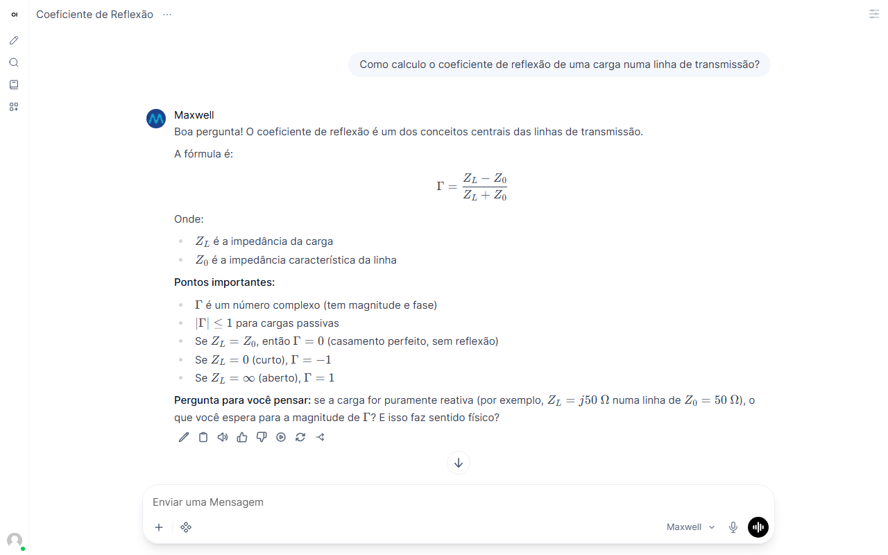

# Maxwell

> [!CAUTION]
> **O Maxwell pode errar. Não confie 100% nas respostas.**
> Ele é uma ferramenta de apoio ao estudo e não substitui o professor, o livro ou as aulas. Sempre confira fórmulas, valores e resoluções com o material da disciplina.

Assistente de estudo com IA para a disciplina de **Eletromagnetismo II** da UFES.

Em vez de entregar a resposta pronta, o Maxwell guia o aluno com perguntas e dicas, como um monitor. Foco atual: **Linhas de Transmissão**.

## O que ele faz

| Modo | Para quê |
|---|---|
| **Maxwell** | Tirar dúvidas, com dicas passo a passo |
| **Revisão** | Treinar para a prova com perguntas rápidas |
| **Cartões Anki** | Gerar cartões de memorização para o [Anki](docs/GUIA_ALUNO.md#5-cartões-anki) |
| **Exercícios** | Resolver exercícios junto com o aluno, depois que ele tenta |
| **Plano de estudo** | Montar um roteiro de estudo até a prova |



## Como funciona

```
Aluno ──► Chat no navegador ──► Maxwell ──► Modelo de IA
                                   │
                                   ├─ consulta o livro e as notas da disciplina
                                   ├─ segue regras de ensino (não entrega a resposta pronta)
                                   └─ usa uma calculadora própria para as contas
```

O modelo de IA pode ser um serviço gratuito na internet (Groq) ou rodar no próprio computador.

## Como rodar

Você vai precisar de:

- **Docker Desktop**, o programa que roda o Maxwell. Se você não tem, siga o [tutorial oficial de instalação](https://docs.docker.com/get-started/get-docker/).
- **Uma chave gratuita do Groq**, o serviço de IA que recomendamos para testar. Veja [como obter a chave](docs/TUTORIAL_LLM.md).

Depois:

1. Copie o arquivo `.env.example` para `.env` e preencha:
   - `LLM_API_KEY`: a chave do Groq;
   - `WEBUI_SECRET_KEY`: qualquer texto longo e aleatório (funciona como uma senha interna);
   - `WEBUI_ADMIN_EMAIL` e `WEBUI_ADMIN_PASSWORD`: o e-mail e a senha do administrador.
2. Abra um terminal na pasta do projeto e rode:

   ```bash
   docker compose up -d --build
   docker compose --profile setup run --rm configurar
   ```

3. Acesse **http://localhost:3000** e entre com o e-mail e a senha do administrador. O [guia do administrador](docs/GUIA_ADMIN.md) mostra, com imagens, o que dá para fazer: aprovar alunos, ver as avaliações, ligar e desligar modos.

> As notas de estudo da disciplina já vêm no repositório. O livro não vem, por direitos autorais: peça os arquivos à equipe.

## Rodar a IA no próprio computador

É possível, mas precisa de placa de vídeo NVIDIA:

| Uso | Placa de vídeo |
|---|---|
| Testar | 6 GB |
| Apresentar com boa qualidade | 8 a 12 GB |
| Turma inteira usando | 24 GB ou mais |

Sem placa de vídeo, funciona, mas fica lento demais para uso real. Treinar um modelo próprio não é necessário por enquanto: o Maxwell se especializa pelas regras de ensino e pelo material da disciplina.

## Documentação

- [Guia do aluno](docs/GUIA_ALUNO.md)
- [Guia do administrador](docs/GUIA_ADMIN.md)
- [Como obter a chave ou rodar a IA localmente](docs/TUTORIAL_LLM.md)
- [Comparação das opções de IA](docs/OPCOES_LLM.md)
- [Como adicionar material ao Maxwell](docs/DESENVOLVIMENTO.md#como-adicionar-material)
- [Pesquisa sobre IA no estudo](docs/PESQUISA_IA_ESTUDO.md)
- [Guia técnico](docs/DESENVOLVIMENTO.md)

## Licença

Código sob a [licença MIT](LICENSE). O material da disciplina pertence aos respectivos autores.
