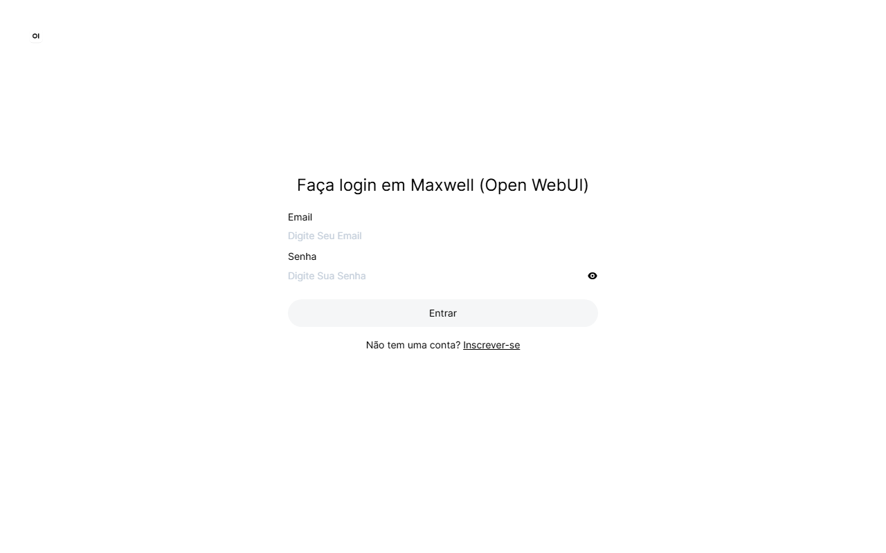
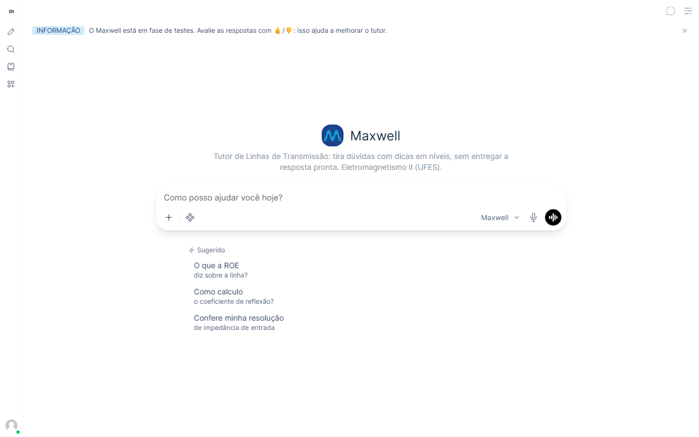
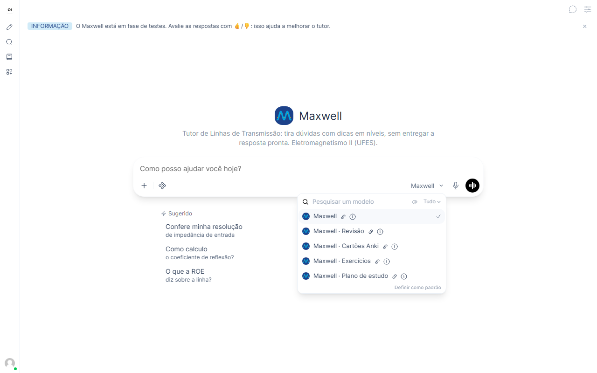
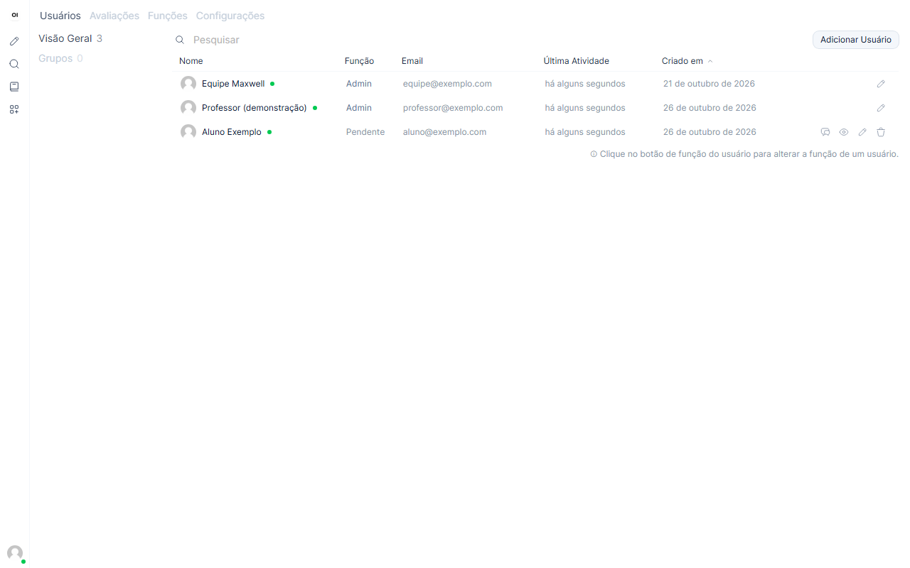
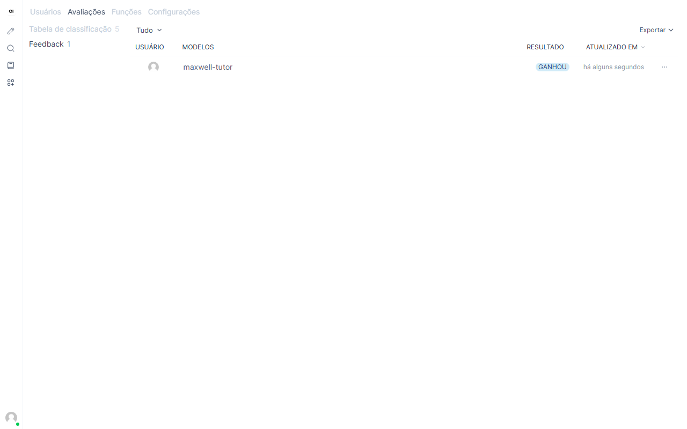
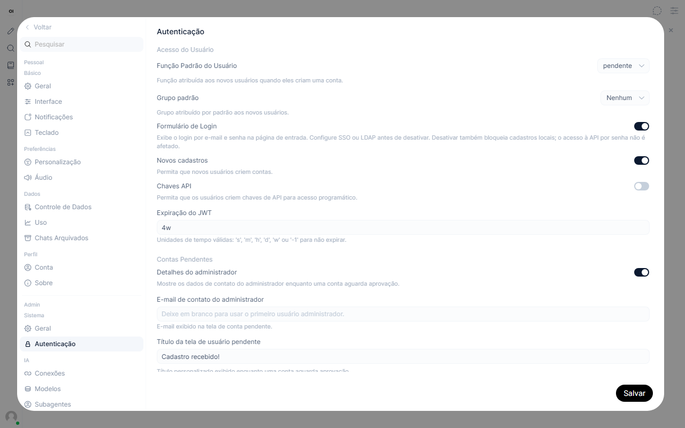
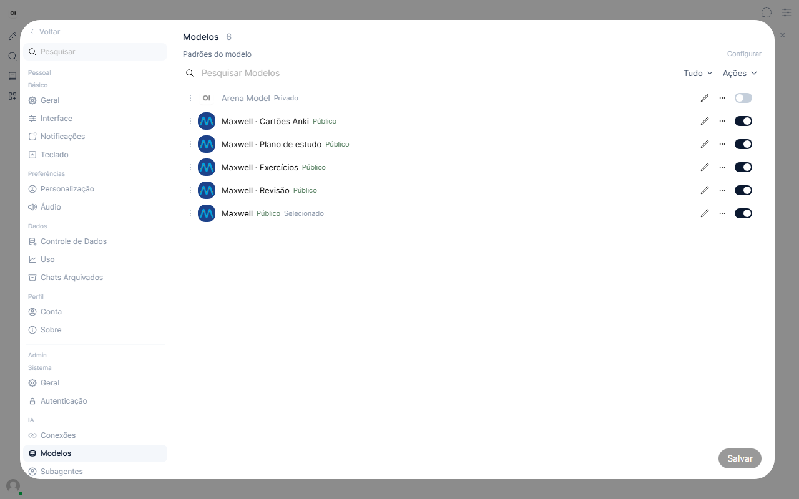
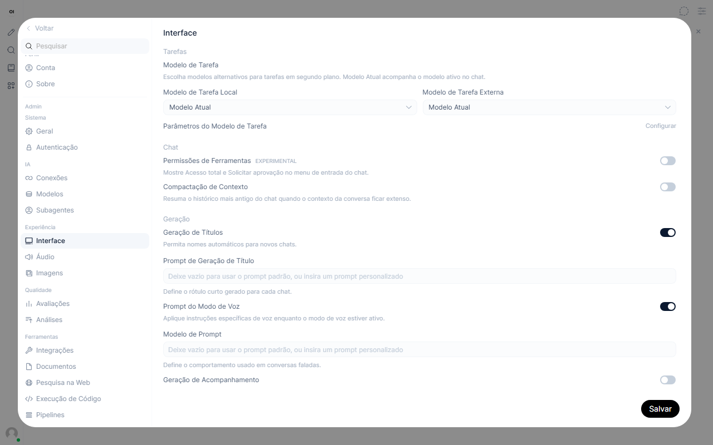

# Guia do administrador

O que o administrador (professor ou monitor) pode fazer no Maxwell. Tudo é feito pelo navegador, sem programação.

## 1. Entrar

Acesse **http://localhost:3000** e entre com o e-mail e a senha do administrador (os mesmos do arquivo `.env`).

## 2. O que o aluno vê

Na tela inicial, o aluno escreve a pergunta ou clica numa sugestão. O modo ativo aparece ao lado da caixa de texto.

Clicando no nome do modo, ele troca entre os cinco modos do Maxwell:

O Maxwell responde com as fórmulas formatadas e, em vez de entregar tudo pronto, termina com uma pergunta para o aluno pensar:

## 3. Aprovar alunos

Quando um aluno se cadastra, a conta fica **pendente** até ser aprovada.

1. Abra **Painel Admin → Usuários** (http://localhost:3000/admin/users).
2. Clique em **Pendente**, na coluna *Função* do aluno, para mudar para **Usuário**.

Nessa mesma tela dá para cadastrar alunos manualmente (**Adicionar Usuário**), editar contas (o lápis também troca a senha de quem esqueceu) e excluí-las.

## 4. Ver as avaliações dos alunos

Os alunos podem marcar 👍 ou 👎 em cada resposta. Para ver as avaliações, abra **Painel Admin → Avaliações → Feedback**. É o melhor retorno para saber onde o Maxwell erra ou explica mal. O botão **Exportar** baixa tudo em planilha.

## 5. Controlar os cadastros

Em **Painel Admin → Configurações → Autenticação**:

- **Função padrão do usuário = pendente**: todo novo aluno precisa de aprovação (recomendado).
- **Novos cadastros**: desligue para fechar as inscrições.

## 6. Ligar e desligar modos

Em **Painel Admin → Configurações → Modelos**, cada chave liga ou desliga um modo para os alunos. Por exemplo, dá para desligar o modo **Exercícios** durante uma prova. O lápis abre a edição do nome e da descrição.

## 7. Avisos e economia de uso

Em **Painel Admin → Configurações → Interface**:

- **Geração de Títulos** dá nome automático às conversas. As sugestões automáticas (*Geração de Acompanhamento*) ficam desligadas para economizar o limite de uso do serviço de IA gratuito.
- Mais abaixo, em **Banners**, dá para publicar um aviso no topo da tela para todos os alunos.

## Bom saber

- **Limite do serviço gratuito:** muitas perguntas no mesmo minuto deixam as respostas lentas. Se passar do limite, o Maxwell avisa o aluno para esperar uns 30 segundos.
- **Configuração padrão:** o comando `docker compose --profile setup run --rm configurar` reaplica as configurações do projeto e **desfaz mudanças feitas à mão** nos modos, nos cadastros e nos avisos.
