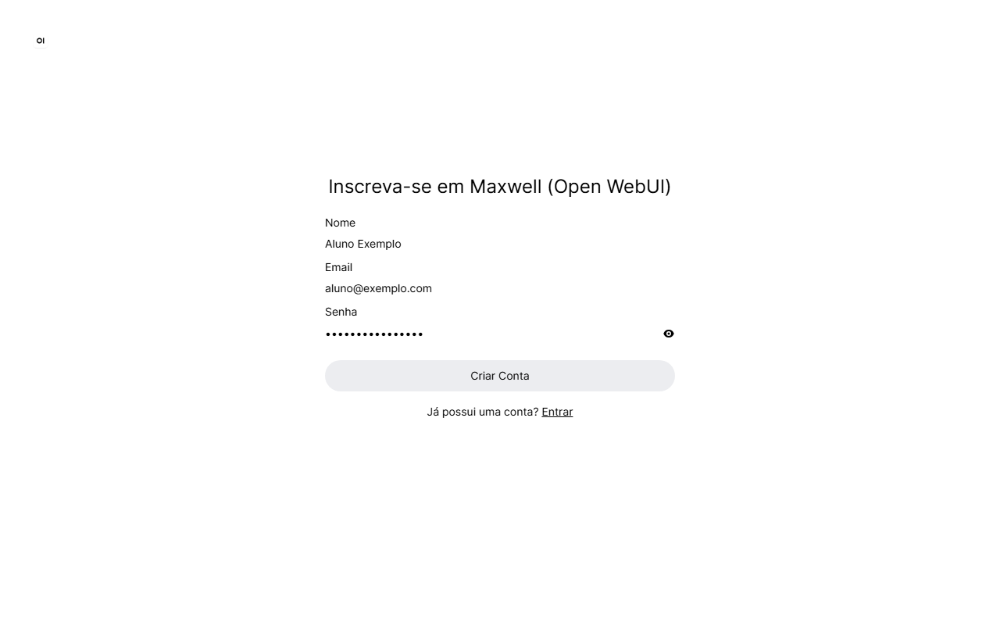
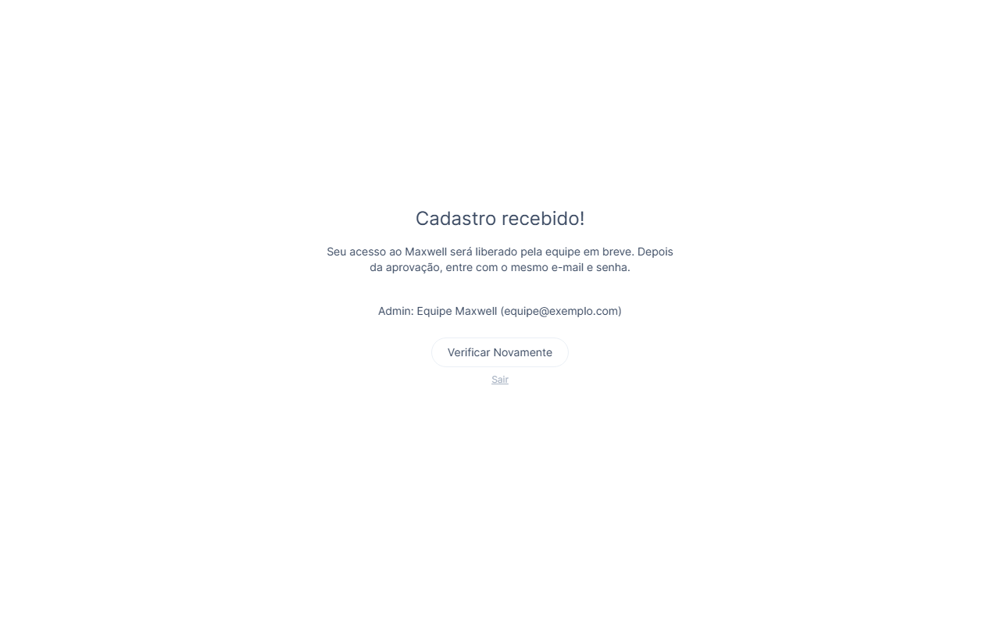

# Guia do aluno

O Maxwell é um monitor de estudo de Eletromagnetismo II. Ele **não entrega a resposta pronta**: faz perguntas e dá dicas para você chegar lá sozinho. É assim que o conteúdo fixa para a prova.

## 1. Criar a conta

1. Acesse o endereço do Maxwell informado pelo professor.
2. Clique em **Inscrever-se** e preencha nome, e-mail e senha.

3. Aguarde a aprovação do professor ou do monitor. Depois de aprovado, clique em **Verificar Novamente**.

## 2. Escolher o modo

Clique no nome do modo, ao lado da caixa de texto, para trocar:

| Modo | Use quando... |
|---|---|
| **Maxwell** | tiver uma dúvida de conceito ou travar num exercício |
| **Exercícios** | quiser resolver um exercício específico, passo a passo |
| **Revisão** | quiser se testar antes da prova |
| **Cartões Anki** | quiser memorizar fórmulas com cartões |
| **Plano de estudo** | precisar organizar o tempo até a prova |

## 3. Como perguntar bem

- **Mande o enunciado completo**, com valores e unidades.
- **Mostre o que você já tentou**, mesmo que esteja errado. Quanto mais você mostra, mais certeira é a ajuda.
- **Uma dúvida por mensagem.**
- **Responda às perguntas do Maxwell.** É assim que ele passa para a próxima dica.
- Impedâncias podem ser escritas como `75+j25`, `50∠30°`, `curto` ou `aberto`.

| ❌ Evite | ✅ Prefira |
|---|---|
| "Resolve o 11.16 pra mim." | "No 11.16 (coaxial em curto, Z0 = 65+j38 Ω, γ = 0,7+j2,5 /m, ℓ = 0,8 m), usei Zcc = Z0·tgh(γℓ), mas não sei calcular a tgh de um número complexo." |
| "Não entendi carta de Smith." | "Na carta de Smith, por que andar em direção ao gerador é no sentido horário?" |

## 4. O que esperar

- **Dicas antes da resposta.** Insistir não adianta: tente, e ele corrige o seu raciocínio. Nos modos **Revisão** e **Cartões Anki**, as respostas vêm diretas.
- **Contas conferidas.** Ele usa uma calculadora própria e consulta as notas da disciplina.
- **Ele pode errar.** Confira com o livro, as notas e o professor. O Maxwell é um apoio, não substitui a aula.
- **Foco atual:** Linhas de Transmissão.

## 5. Avalie as respostas

Embaixo de cada resposta há 👍 e 👎. Avaliar ajuda a equipe a encontrar e corrigir os erros do Maxwell.

## 6. Se algo der errado

- **"⏳ Muitas perguntas ao mesmo tempo"**: o serviço de IA atingiu o limite de uso. Espere uns 30 segundos e mande de novo.
- **Resposta estranha:** clique em 🔄 (*Gerar novamente*) ou reformule a pergunta.
- **Esqueceu a senha:** fale com o professor ou o monitor.

## Boas práticas

- As conversas ficam salvas no servidor da disciplina: **não compartilhe dados pessoais**.
- Em provas e trabalhos avaliados, use o Maxwell só se o professor permitir.
